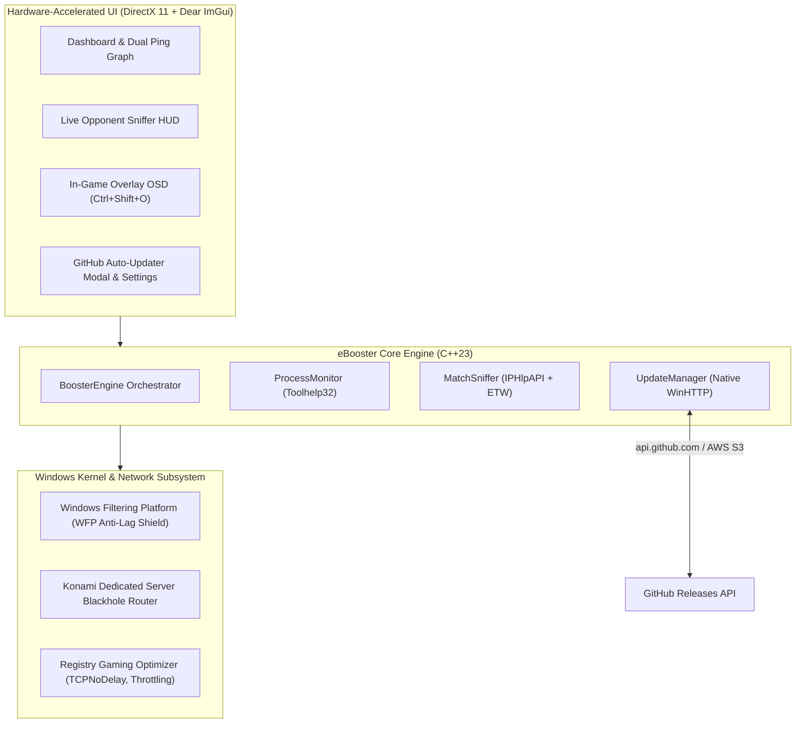

# 🚀 eBooster Pro - High-Performance Windows Game Booster & Network Optimizer

[-blue.svg?style=flat-square&logo=windows)](https://microsoft.com/windows)
[](https://en.cppreference.com/w/cpp/23)
[](https://github.com/ocornut/imgui)
[-brightgreen.svg?style=flat-square)](#-anti-cheat-safety-guarantee)
[](https://github.com/anasx07/eBooster/releases)
[](https://github.com/anasx07/eBooster/actions/workflows/ci.yml)
[](LICENSE)

**eBooster Pro** is an open-source, ultra-low-latency Windows desktop game optimization engine and dedicated server region lock engineered in **Modern C++23**.

Built specifically for competitive esports titles like **eFootball™ 2025/2026**, **Counter-Strike 2 (CS2)**, **Valorant**, **Apex Legends**, and **Overwatch 2**, eBooster combines hardware-accelerated DirectX 11 desktop UI, kernel-level **Windows Filtering Platform (WFP)** packet filtering, real-time matchmaking sniffing, in-game floating overlay HUD, and a built-in **GitHub Releases Auto-Update engine**.

---

## 📑 Table of Contents
- [Core Features](#-core-features)
  - [1. eFootball™ Konami Dedicated Server Lock](#-1-efootball-konami-dedicated-server-lock)
  - [2. Anti-TCP Lag Shield](#-2-anti-tcp-lag-shield-wfp-kernel-firewall)
  - [3. In-App GitHub Releases Auto-Updater](#-3-in-app-github-releases-auto-updater)
  - [4. Live Match Sniffer & Opponent Geolocation](#-4-live-match-sniffer--opponent-geolocation)
  - [5. Mini In-Game DirectX 11 Overlay HUD](#-5-mini-in-game-directx-11-overlay-hud)
  - [6. Windows Gaming Network Optimizer](#-6-windows-gaming-network-optimizer)
  - [7. OBS-Style Active Windows & Tab Picker](#-7-obs-style-active-windows--tab-picker)
- [Anti-Cheat Safety Guarantee](#-anti-cheat-safety-guarantee)
- [Pro Tip: Ping vs. Stability](#-pro-tip-ping-vs-stability-why-40ms-can-beat-20ms)
- [System Architecture](#-system-architecture)
- [Project Structure](#-project-structure)
- [Quick Start & Installation](#-quick-start--installation)
- [Building from Source](#-building-from-source)
- [How Updates Work (For Maintainers & Users)](#-how-updates-work-for-maintainers--users)
- [License](#-license)

---

## 🌟 Core Features

### ⚽ 1. eFootball™ Konami Dedicated Server Lock
- **Real-Time Cloud Endpoint Latency**: Live ICMP/UDP RTT benchmarking to all global Konami clusters (Madrid, Frankfurt, Paris, Milan, London, Zurich, Riyadh, Tokyo, etc.).
- **Dynamic Ping Sorting**: Automatically benchmarks and sorts reachable clusters by lowest latency first, highlighting the **★ BEST** server.
- **Auto-Best Server Lock**: Automatically binds matchmaking to the lowest-latency server cluster on application boot.
- **Manual Cluster Lock**: Lock onto any preferred region (e.g., Frankfurt vs Madrid) to bypass congested local ISP routes and avoid laggy peer-to-peer fallbacks.
- **Zero Virtual Adapters**: Pure network-level firewall filtering—no extra network interfaces, no virtual TAP adapters, zero driver clutter.

### 🛡️ 2. Anti-TCP Lag Shield (WFP Kernel Firewall)
- **Eliminates Match Input Delay**: Some game engines silently fall back to TCP during micro-congestion, causing severe input delay and queueing.
- **Kernel-Level Enforcement**: Uses the Windows Filtering Platform (`FWPM_SUBLAYER`) to block unwanted TCP fallbacks and guarantee 100% pure, jitter-free UDP datagram transmission.
- **Zero Overhead**: In-kernel stateless packet filtering with sub-microsecond latency.

### 🔄 3. In-App GitHub Releases Auto-Updater
- **Zero-Dependency WinHTTP Engine**: Built using native Windows HTTP (`winhttp.dll`), with zero external dependencies (no libcurl, no external downloaders).
- **SemVer Automatic Detection**: Compares current version against the GitHub Releases API (`api.github.com/repos/{owner}/{repo}/releases/latest`).
- **Background Asset Download**: Streams updates in the background with real-time download progress (downloaded MB, total size, and percentage).
- **Follows GitHub / AWS S3 Redirects**: Full HTTP 302 redirect handling for binary assets hosted on Amazon S3.
- **Atomic In-Place Update**: Leverages Windows NT binary swap (`MoveFileW` rename trick) to replace the running executable seamlessly and restart without requiring an external installer or UAC prompt.
- **Configurable Repository**: Easily change the target GitHub repository (`owner/repo`) directly from the Settings page.

### 📡 4. Live Match Sniffer & Opponent Geolocation
- **Kickoff Auto-Detection**: Automatically detects when a competitive match starts via extended TCP/UDP table inspection.
- **Opponent Dossier**: Displays opponent IP, country flag, ISP name, and live ping.
- **Historical Match Log**: Tracks connection stability and latency spikes across your session history.

### 🖥️ 5. Mini In-Game DirectX 11 Overlay HUD
- **Real-Time Telemetry**: Seamless, semi-transparent HUD rendered directly over borderless and windowed games.
- **Key Metrics**: Shows current ping, real-time jitter (standard deviation $\sigma$), dynamic packet loss %, locked server cluster, and opponent location.
- **Global In-Game Hotkeys**:
  - `Ctrl + Shift + O`: Toggle In-Game Overlay HUD.
  - `Ctrl + Shift + B`: Instant In-Game Boost toggle.

### ⚡ 6. Windows Gaming Network Optimizer
- **Nagle's Algorithm (`TcpAckFrequency` / `TCPNoDelay`)**: Disables delayed ACK timers for instant packet transmission.
- **Network Throttling Index**: Removes the built-in Windows multimedia network rate limiter (`NetworkThrottlingIndex = 0xFFFFFFFF`).
- **System Responsiveness**: Sets multimedia gaming priority to 0% CPU starvation reserve (`SystemResponsiveness = 0`).
- **UDP Socket Buffer Expansion**: Increases WinSock send/receive ring buffers to eliminate bufferbloat and packet drops.

### 🎯 7. OBS-Style Active Windows & Tab Picker
- **Visual Process Selection**: Pick any open desktop window or browser tab directly from an OBS-style interactive list.
- **Targeted Anti-Lag**: Optimizes specific games or applications without manually typing `.exe` names or searching through directories.

---

## 🛡️ Anti-Cheat Safety Guarantee

eBooster Pro is engineered to be **100% non-invasive and anti-cheat safe**:

| Technique | eBooster Status | Why It Matters |
| :--- | :---: | :--- |
| **DLL Injection** | ❌ **NEVER** | Zero code injected into game processes. |
| **Memory Modification (`WriteProcessMemory`)** | ❌ **NEVER** | Never touches or reads game memory. |
| **Function Detours / Hooks** | ❌ **NEVER** | No hooks inside game address space. |
| **Process Handles** | ❌ **NEVER** | Operates without opening elevated handles to games. |
| **Virtual Kernel Drivers** | ❌ **NEVER** | No virtual TAP/Tun adapters or third-party drivers. |
| **Sanctioned OS APIs** | ✅ **100%** | Pure Windows Filtering Platform (`fwpuclnt.dll`) & WinSock. |

> **Anti-Cheat Compatibility**: Verified safe for **VAC (Valve Anti-Cheat)**, **Easy Anti-Cheat (EAC)**, **BattlEye**, **Riot Vanguard**, and **Ricochet**.

---

## 💡 Pro Tip: Ping vs. Stability (Why 40ms Can Beat 20ms)

When selecting a dedicated server, **raw ping is only half the story — connection stability determines fluid gameplay:**

```
Madrid (25 ms)    :  ▲▼▲▼▲▼▲ (Jitter & Bufferbloat = Heavy input delay / rubberbanding)
Frankfurt (42 ms) :  ─────── (Flat 5-Bar Line = Crisp response & fluid animations)
```

> **Competitive Advice**: Test servers one by one and check the in-game **Network Graph** after matches. If a 25ms server displays erratic spikes (jitter dips down to 3 bars), lock a slightly higher ping server (e.g., 42ms Frankfurt or Zurich) that maintains a flat, rock-solid 5-bar line!

---

## 🏗️ System Architecture



---

## 📁 Project Structure

```
eBooster/
├── CMakeLists.txt                    # Modern CMake build configuration (C++23)
├── README.md                         # Project documentation & GitHub guide
├── assets/                           # Application icon, branding, and resource manifest
│   ├── app.ico                       # eBooster icon
│   ├── app.manifest                  # UAC requireAdministrator manifest
│   └── app.rc                        # Windows resource file
├── configs/                          # Default configurations & server lists
│   ├── profiles.json                 # Game process profiles, launchers, and ports
│   ├── servers.json                  # Konami dedicated server clusters & IP ranges
│   └── user_preferences.json         # User settings state & preferences
├── include/                          # C++ header files
│   └── ebooster/
│       ├── Common.hpp                # Win32 RAII wrappers, logger, IP utilities
│       ├── ProcessMonitor.hpp        # Toolhelp32 process watcher
│       ├── ConnectionSniffer.hpp     # IPHlpAPI TCP/UDP connection sniffer
│       ├── EtwSniffer.hpp            # ETW kernel event sniffer
│       ├── MatchSniffer.hpp          # Real-time game match sniffer & geolocator
│       ├── NetworkOptimizer.hpp      # WFP Anti-TCP Shield & Konami server lock
│       ├── InGameOverlay.hpp         # DirectX 11 in-game HUD overlay
│       ├── UpdateManager.hpp         # GitHub Releases WinHTTP updater
│       ├── UserPreferences.hpp       # Preferences persistence manager
│       ├── ProfileManager.hpp        # Game profiles serializer
│       ├── SteamDetector.hpp         # Automatic Steam library & games detector
│       ├── TextureLoader.hpp         # DirectX 11 texture loader
│       └── BoosterEngine.hpp         # Central orchestrator
├── src/                              # C++ implementation files
│   ├── gui_main.cpp                  # WinMain entry point & Per-Monitor V2 DPI setup
│   ├── GuiApp.cpp                    # Full DirectX 11 + Dear ImGui application UI
│   ├── UpdateManager.cpp             # WinHTTP GitHub client & in-place restart
│   ├── UserPreferences.cpp           # JSON settings reader & writer
│   ├── NetworkOptimizer.cpp          # WFP firewall rules & gaming registry tweaks
│   ├── MatchSniffer.cpp              # Match packet sniffer & opponent geolocation
│   ├── InGameOverlay.cpp             # Mini floating OSD overlay implementation
│   ├── ProcessMonitor.cpp            # Game start/exit watcher
│   ├── ProfileManager.cpp            # Profile loader
│   ├── SteamDetector.cpp             # Steam games detection
│   └── BoosterEngine.cpp             # Engine lifecycle controller
└── scripts/
    ├── build_release.ps1             # Automated release packager & zip builder
    ├── build_msvc.bat                # Visual Studio 2022/2026 build script
    ├── build_mingw.bat               # MinGW-w64 build script
    └── run_admin.bat                 # Elevation launcher wrapper
```

---

## ⚡ Quick Start & Download

Download the latest release for Windows from the [GitHub Releases page](https://github.com/anasx07/eBooster/releases):

| Distribution | File | Best For | Features |
| :--- | :--- | :--- | :--- |
| 📦 **Installer** *(Recommended)* | `eBooster-Setup.exe` | Most Gamers | Installs into `Program Files`, adds Start Menu & Desktop shortcuts, registers clean Uninstaller in Windows. |
| 🚀 **Portable** | `eBooster-Portable.exe` | Zero-Install & USB | Single standalone executable. Run anywhere without installing or writing to Desktop. |

### How to Use:
1. Download **`eBooster-Setup.exe`** (or **`eBooster-Portable.exe`**).
2. Launch eBooster (it automatically requests Administrator elevation for WFP kernel packet filtering).
3. Select your game profile (e.g. **eFootball [Steam]**).
4. Activate the **Anti-Lag Shield** and select your preferred dedicated server region.
5. Launch your game and play with minimum latency!

---

## 🛠️ Building from Source

### Prerequisites
- **OS**: Windows 10 or Windows 11 (64-bit)
- **CMake**: Version 3.25 or newer
- **Compiler**:
  - **Visual Studio 2022 / 2026** (Desktop development with C++) — *Recommended*
  - OR **MinGW-w64** (GCC 14+ with C++23 support)

### 1. Build with Visual Studio (MSVC)
```powershell
# Configure CMake
cmake -B build_msvc -S .

# Build Release binary (/MT static runtime, embedded manifest)
cmake --build build_msvc --config Release --parallel
```
The compiled standalone binary will be located at:
`build_msvc\Release\eBooster.exe` (1.9 MB, zero runtime dependencies).

### 2. Build Standalone Release Binary (One-Click)
To automatically compile and stage the standalone executable into `dist/`:
```powershell
powershell -ExecutionPolicy Bypass -File scripts\build_release.ps1 -Version "v1.0"
```
Output:
- `dist\eBooster.exe` (1.9 MB standalone portable binary)

---

## 🔄 How Updates Work (For Maintainers & Users)

### For End-Users:
- When a new version is released on GitHub, a notification button appears in the **Top Bar** (`Update Available!`) and inside **Settings**.
- Clicking **Download & Install** downloads the new standalone binary with a live progress bar.
- Clicking **Restart & Install** swaps the executable instantly and restarts into the new version—no re-installation needed.

### For Maintainers (Automated One-Click Release CLI):
eBooster includes a dedicated Release CLI tool that automates the entire version bump, compilation, tagging, and GitHub publishing process:

```powershell
# Interactive wizard (prompts for version bump, title, and changelog)
.\release.bat

# Or direct command-line bump:
.\release.bat -Bump patch                  # e.g. v1.0.0 -> v1.0.1
.\release.bat -Bump minor                  # e.g. v1.0.0 -> v1.1.0
.\release.bat -Version "v1.2.0" -Title "eBooster v1.2.0" -Notes "Major update"
```

The CLI automatically:
1. Updates `CMakeLists.txt` and C++ `EBOOSTER_VERSION` headers.
2. Builds the standalone Visual Studio MSVC binary (`/MT`).
3. Creates the distribution ZIP package in `dist/`.
4. Commits, tags, and pushes to `origin/main --tags`.
5. Publishes the release to GitHub and uploads `eBooster.exe` (via GitHub CLI, GitHub Personal Access Token, or automated browser draft).
6. All existing client apps instantly receive the update notification!

---

## 📄 License

This project is licensed under the [MIT License](LICENSE).  
Contributions, issue reports, and pull requests are welcome!
