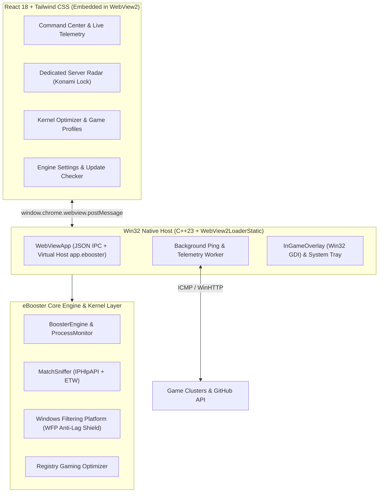

# 🚀 eBooster Pro - High-Performance Windows Game Booster & Anti-Lag WFP Shield

[-blue.svg?style=flat-square&logo=windows)](https://microsoft.com/windows)
[](https://en.cppreference.com/w/cpp/23)
[](https://react.dev/)
[-brightgreen.svg?style=flat-square)](#-anti-cheat-safety-guarantee)
[](https://github.com/anasx07/eBooster/releases)
[](https://github.com/anasx07/eBooster/actions/workflows/ci.yml)
[](LICENSE)

**eBooster Pro** is an open-source, ultra-low-latency Windows desktop game optimization engine and dedicated server region lock engineered in **Modern C++23** with a **Microsoft WebView2 + React 18 / Tailwind CSS** esports dashboard.

Built specifically for competitive esports titles like **eFootball™ 2025/2026**, **Counter-Strike 2 (CS2)**, **Valorant**, **Apex Legends**, and **Rocket League**, eBooster combines a **1.4 MB** zero-dependency native C++23 executable, kernel-level **Windows Filtering Platform (WFP)** packet filtering, real-time matchmaking sniffing, a transparent Win32 in-game HUD overlay, and an automated **GitHub Releases** update engine.

---

## 📑 Table of Contents
- [Core Features](#-core-features)
  - [1. Modern WebView2 + React 18 Esports Dashboard](#-1-modern-webview2--react-18-esports-dashboard)
  - [2. eFootball™ Konami Dedicated Server Lock](#-2-efootball-konami-dedicated-server-lock)
  - [3. Anti-TCP Lag Shield (WFP Kernel Firewall)](#-3-anti-tcp-lag-shield-wfp-kernel-firewall)
  - [4. Live Telemetry & Match Sniffer](#-4-live-telemetry--match-sniffer)
  - [5. Mini In-Game Overlay HUD](#-5-mini-in-game-overlay-hud)
  - [6. Windows Gaming Kernel Optimizer](#-6-windows-gaming-kernel-optimizer)
  - [7. In-App GitHub Releases Auto-Updater](#-7-in-app-github-releases-auto-updater)
- [Anti-Cheat Safety Guarantee](#-anti-cheat-safety-guarantee)
- [Pro Tip: Ping vs. Stability](#-pro-tip-ping-vs-stability-why-40ms-can-beat-20ms)
- [System Architecture](#-system-architecture)
- [Project Structure](#-project-structure)
- [Quick Start & Download](#-quick-start--download)
- [Building from Source](#-building-from-source)
- [Contributing](#-contributing)
- [License](#-license)

---

## 🌟 Core Features

### 🎨 1. Modern WebView2 + React 18 Esports Dashboard
- **eFootball Stadium Theme**: Deep Midnight Navy (`#080B14`), Electric Stadium Blue (`#00A3FF`), Neon Magenta (`#FF007F`), glassmorphism cards, and Lucide vector icons.
- **Zero-Bloat Native Host**: Powered by **Microsoft WebView2** statically linked via `WebView2LoaderStatic.lib` (`/MT`) — **1.4 MB** total binary size with zero external runtime DLLs (unlike Electron's 150+ MB footprint).
- **Single-File Offline UI**: The compiled React bundle (`ui/dist/index.html`) is embedded directly into the executable as a Win32 `RCDATA` resource, making `eBooster-Portable.exe` **100% standalone** even on USB drives.
- **Native Frameless Window**: Hardware-accelerated borders, native Aero Snap dragging, multi-monitor DPI scaling (`Per-Monitor V2`), and System Tray docking.

### ⚽ 2. eFootball™ Konami Dedicated Server Lock
- **Real-Time Cloud Endpoint Benchmarking**: Parallel ICMP latency probing across all 28+ global Konami clusters (Frankfurt, Paris, Madrid, London, Milan, Amsterdam, Warsaw, Istanbul, Riyadh, Sao Paulo, Tokyo, etc.).
- **Auto-Lock**: Automatically engages your preferred low-latency dedicated server cluster on startup.
- **Zero Virtual Adapters**: Pure WFP network-level filtering — no virtual TAP/TUN interfaces, no VPN overhead, zero driver clutter.

### 🛡️ 3. Anti-TCP Lag Shield (WFP Kernel Firewall)
- **Eliminates Match Input Delay**: Prevents game engines from silently falling back to TCP on ports `30000-35000` & `5736` during micro-congestion.
- **Kernel-Level Enforcement**: Uses the Windows Filtering Platform (`FWPM_SUBLAYER`) to guarantee pure, jitter-free UDP datagram transmission with sub-microsecond overhead.

### 📡 4. Live Telemetry & Match Sniffer
- **Real-Time Metrics**: Background ICMP probe thread tracks live ping, rolling jitter, and packet loss percentage in real time.
- **Kickoff Auto-Detection**: Detects active matches via `IPHlpAPI` and Kernel ETW socket tracing, displaying server IP, cluster location, and packet rate.
- **Zero-Click Auto-Boost**: Automatically engages WFP rules when your game (or its child processes) launches, and cleanly disengages when you exit.

### 🖥️ 5. Mini In-Game Overlay HUD
- **Ultra-Lightweight Win32 GDI HUD**: Semi-transparent, click-through floating telemetry bar rendered on top of borderless/windowed games.
- **Global In-Game Hotkeys**:
  - `Ctrl + Shift + B`: Instant In-Game Boost toggle.
  - `Ctrl + Shift + O`: Toggle In-Game Overlay HUD.

### ⚡ 6. Windows Gaming Kernel Optimizer
- **Nagle's Algorithm (`TcpAckFrequency` / `TCPNoDelay`)**: Disables delayed ACK packing across active adapters.
- **Network Throttling Index**: Sets `NetworkThrottlingIndex = 0xFFFFFFFF` to remove Windows' 10-packet/ms multimedia cap.
- **System Responsiveness & MMCSS Priority**: Sets `SystemResponsiveness = 0` and elevates gaming scheduler priority (`Priority = 6`, `High`).
- **DWM Multiplane Overlay (MPO) Fix**: Sets `OverlayTestMode = 5` to eliminate GPU micro-stuttering in borderless fullscreen games.

### 🔄 7. In-App GitHub Releases Auto-Updater
- **Zero-Dependency WinHTTP Engine**: Checks `api.github.com/repos/anasx07/eBooster/releases/latest` natively with AWS S3 redirect support.
- **Atomic In-Place Replacement**: Swaps the running executable cleanly using Windows NT rename semantics and restarts into the latest version.

---

## 🛡️ Anti-Cheat Safety Guarantee

eBooster Pro is engineered to be **100% non-invasive and anti-cheat safe**:

| Technique | eBooster Status | Why It Matters |
| :--- | :---: | :--- |
| **DLL Injection** | ❌ **NEVER** | Zero code injected into game processes. |
| **Memory Modification (`WriteProcessMemory`)** | ❌ **NEVER** | Never touches or reads game memory. |
| **Function Detours / Hooks** | ❌ **NEVER** | No hooks inside game address space. |
| **Process Handles** | ❌ **NEVER** | Operates without opening elevated handles to games. |
| **Virtual Kernel Drivers** | ❌ **NEVER** | No virtual TAP/TUN adapters or third-party drivers. |
| **Sanctioned OS APIs** | ✅ **100%** | Pure Windows Filtering Platform (`fwpuclnt.dll`) & WinSock. |

> **Anti-Cheat Compatibility**: Safe for **VAC (Valve Anti-Cheat)**, **Easy Anti-Cheat (EAC)**, **BattlEye**, **Riot Vanguard**, and **Ricochet**.

---

## 💡 Pro Tip: Ping vs. Stability (Why 40ms Can Beat 20ms)

When selecting a dedicated server, **raw ping is only half the story — connection stability determines fluid gameplay:**

```text
Madrid (25 ms)    :  ▲▼▲▼▲▼▲ (Jitter & Bufferbloat = Heavy input delay / rubberbanding)
Frankfurt (42 ms) :  ─────── (Flat 5-Bar Line = Crisp response & fluid animations)
```

> **Competitive Advice**: Test clusters using **PING ALL** in the Dedicated Servers tab. If a lower-ping cluster shows erratic spikes, lock a slightly higher-ping cluster with flat jitter for rock-solid responsiveness.

---

## 🏗️ System Architecture



---

## 📁 Project Structure

```text
eBooster/
├── .github/workflows/                # CI verification & automated Release/Winget pipelines
├── assets/                           # App icon, UAC manifest, and app.rc (embeds UI RCDATA 101)
├── configs/                          # Default game profiles and user preferences templates
├── docs/                             # DevOps & code signing documentation
├── include/ebooster/                 # Modern C++23 headers (1:1 with src/)
│   ├── BoosterEngine.hpp             # Core engine coordinator
│   ├── Common.hpp                    # Win32 RAII handles, logging, path helpers
│   ├── ConnectionSniffer.hpp         # Extended TCP/UDP table polling
│   ├── DnsRelayController.hpp        # Smart DNS routing & DHCP restore
│   ├── EtwSniffer.hpp                # Kernel ETW socket event tracing
│   ├── InGameOverlay.hpp             # Transparent Win32 GDI mini HUD overlay
│   ├── MatchSniffer.hpp              # Live match detection & IP classification
│   ├── NetworkOptimizer.hpp          # Gaming TCP/UDP registry tweaks & WFP Konami geofilter
│   ├── ProcessMonitor.hpp            # Fast game process detection
│   ├── ProfileManager.hpp            # Atomic JSON profile persistence
│   ├── RouteController.hpp           # WFP kernel filter controller
│   ├── SteamDetector.hpp             # Steam library scanner
│   ├── UpdateManager.hpp             # Native WinHTTP GitHub Releases auto-updater
│   ├── UserPreferences.hpp           # Preferences & window geometry persistence
│   └── WebViewApp.hpp                # Native Win32 / WebView2 host & JSON IPC bridge
├── installer/
│   └── eBooster.iss                  # Inno Setup 6/7 installer script (Task Scheduler startup)
├── scripts/
│   ├── build_release.ps1             # Builds MSVC /MT (or MinGW fallback), Inno Setup, checksums
│   ├── generate_icon.ps1             # Multi-resolution .ico generator
│   ├── release.ps1                   # Automated SemVer bump, tag & GitHub release CLI
│   └── setup_webview2.ps1            # Microsoft WebView2 SDK fetcher
├── src/                              # C++23 implementations + gui_main.cpp
├── third_party/
│   ├── json.hpp                      # Single-header nlohmann/json
│   └── webview2/                     # Microsoft.Web.WebView2 SDK (headers + static/import libs)
├── ui/                               # React 18 + Vite 6 + Tailwind CSS 3 + TypeScript frontend
│   ├── dist/                         # Inlined single-file offline bundle
│   ├── src/                          # React components (Dashboard, ServerRadar, Optimizer, etc.)
│   └── inline-dist.mjs               # Bundles JS & CSS into standalone dist/index.html
└── CMakeLists.txt                    # CMake 3.25+ configuration (MSVC /MT & MinGW GCC 15+)
```

---

## ⚡ Quick Start & Download

### Option 1: GitHub Releases
Download the latest release for Windows from the [GitHub Releases page](https://github.com/anasx07/eBooster/releases):

| Distribution | File | Best For | Features |
| :--- | :--- | :--- | :--- |
| 📦 **Installer** *(Recommended)* | `eBooster-Setup.exe` | Most Gamers | Installs into `Program Files`, adds Start Menu & Desktop shortcuts, optional Windows Startup task, clean Uninstaller. |
| 🚀 **Portable** | `eBooster-Portable.exe` | Zero-Install & USB | Single **1.4 MB** self-contained executable with embedded UI & zero external DLLs. |

### Option 2: Windows Package Manager (`winget`)
```powershell
winget install anasx07.eBooster
```

### How to Use:
1. Launch **`eBooster Pro`** (automatically requests Administrator privileges for WFP kernel filtering).
2. Select your game profile in **Game Profiles** (e.g., **eFootball (Steam)**).
3. Click the **Boost** switch on the **Command Center** and optionally lock a low-latency cluster in **Dedicated Servers**.
4. Apply 1-click Windows latency optimizations in **Kernel Optimizer** and play!

---

## 🛠️ Building from Source

### Prerequisites
- **OS**: Windows 10 or Windows 11 (64-bit)
- **Node.js**: 20+ (for building the React UI)
- **CMake**: 3.25 or newer
- **Compiler**:
  - **Visual Studio 2022 / 2026** (Desktop development with C++, Windows SDK `10.0.26100.0+`) — *Recommended for `/MT` zero-DLL build*
  - OR **MinGW-w64** (GCC 15+ with C++23 support)
- **Optional**: Inno Setup 6/7 (`ISCC.exe`) for building `eBooster-Setup.exe`

### 1. Build React UI & Compile (MSVC `/MT` Static)
```powershell
# 1. Install UI dependencies and build single-file dist/index.html
npm ci --prefix ui
npm run build --prefix ui

# 2. Configure and compile MSVC Release binary
cmake -B build_msvc -S .
cmake --build build_msvc --config Release --parallel
```
Output binary: `build_msvc\Release\eBooster.exe` (~1.4 MB, standalone, zero runtime DLLs).

### 2. Build Full Release & Installer (One-Click)
```powershell
powershell -ExecutionPolicy Bypass -File scripts\build_release.ps1 -Version "1.0.4"
```
Outputs staged in `dist/`:
- `dist\eBooster.exe`
- `dist\eBooster-Portable.exe`
- `dist\eBooster-Setup.exe` *(when Inno Setup is installed)*
- `dist\checksums.txt`

---

## 🤝 Contributing

The `main` branch is protected. All contributions must go through a Pull Request:
1. Fork or create a feature branch (`git checkout -b feat/my-feature`).
2. Make your changes and verify both the UI (`npm run build --prefix ui`) and C++ Release build (`cmake --build build_msvc --config Release`).
3. Open a **Pull Request** targeting `main` and ensure the CI check (`Build & Verify (Windows MSVC Release)`) passes.

---

## 📄 License

Distributed under the **MIT License**. See [LICENSE](LICENSE) for more information.
